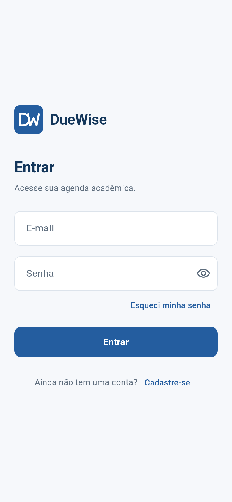
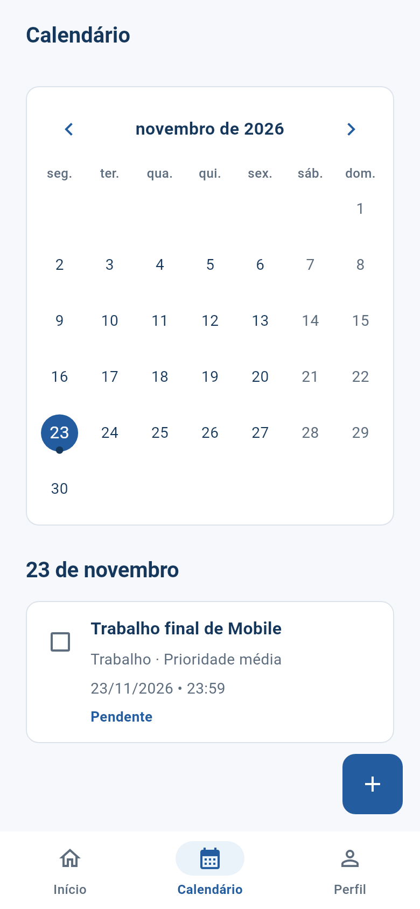

# DueWise

Agenda acadêmica para Android desenvolvida em Flutter e Dart. Permite organizar provas, trabalhos e visitas técnicas por disciplina, prazo e prioridade.

**Integrantes** — Guilherme Roberto Nedochetko e Ruan Pablo Martins.

## Funcionalidades

- Cadastro, login e recuperação de senha com Firebase Authentication.
- Criação, consulta, edição, conclusão e exclusão de atividades. O calendário destaca as datas com atividades e a agenda permite filtrar por tipo e situação.
- Alterações offline ficam no SQLite e são enviadas ao Cloud Firestore quando a conexão volta.
- Localização por GPS e endereço por CEP (ViaCEP) nas atividades. A foto de perfil pode vir da câmera ou da galeria e fica salva no aparelho.

As principais bibliotecas são `firebase_auth`, `cloud_firestore`, `sqflite`, `connectivity_plus`, `table_calendar`, `geolocator`, `http` e `image_picker`. A lista completa está no [pubspec.yaml](pubspec.yaml).

## Executar no Android

Use Flutter 3.44.8 com Dart 3.12.2 e um celular Android 7.0 ou superior com depuração USB. Na primeira configuração, siga o [guia do Firebase](docs/CONFIGURACAO_FIREBASE.md). Conecte o celular e use o identificador exibido por `flutter devices`.

```bash
flutter pub get
flutter devices
flutter run -d ID_DO_CELULAR
```

Para rodar os testes, use `flutter test`. Para gerar o APK de entrega para celulares ARM64, execute o comando abaixo. O arquivo fica em `build/app/outputs/flutter-apk/app-arm64-v8a-release.apk`.

```bash
flutter build apk --release --target-platform android-arm64 --split-per-abi --split-debug-info=build/symbols/arm64
```

## Telas

| Login | Agenda | Calendário |
| --- | --- | --- |
|  |  |  |
