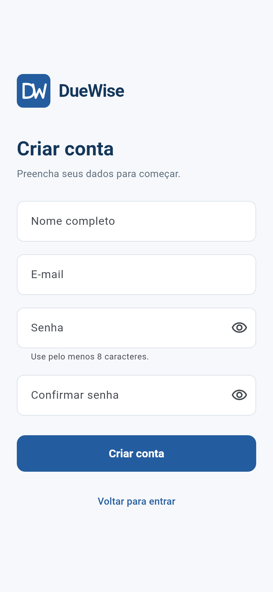
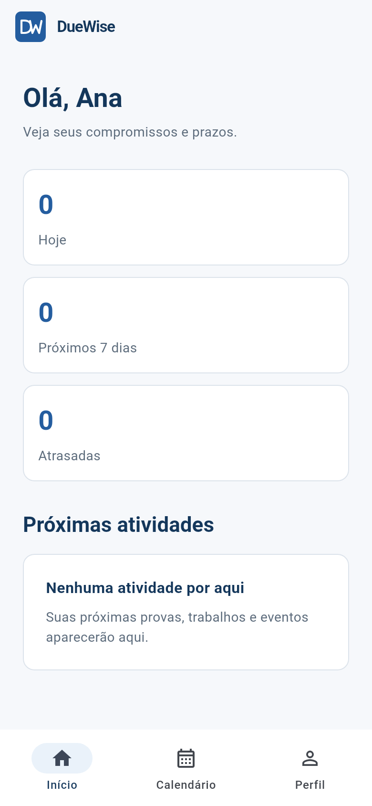
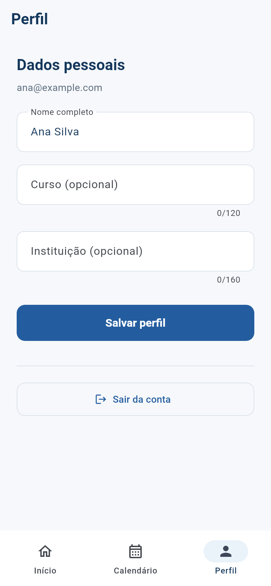

# DueWise

Agenda acadêmica Android em Flutter e Dart. Organização de provas, trabalhos, apresentações, eventos e visitas técnicas.

## Integrante

GNedochetko — preencher nome completo e, se houver, segundo integrante antes da entrega.

## Estado atual: estrutura, identidade visual e autenticação

- Tema exclusivamente claro, tons de azul, componentes discretos e interface em português do Brasil.
- Ícone Android e splash com monge barbudo; monograma DW dentro do aplicativo.
- Cadastro com nome completo, e-mail, senha e confirmação.
- Login, recuperação de senha e logout com Firebase Authentication real.
- Sessão persistida pelo Firebase; acesso às telas internas condicionado à autenticação.
- Validações, carregamento, visibilidade de senha e mensagens de erro.
- Perfil com nome, e-mail, curso e instituição; edição persistida no Firestore.
- Navegação Início / Calendário / Perfil.
- Resumo inicial vazio e calendário com navegação mensal e seleção de data.
- Modelos iniciais de disciplinas e atividades, incluindo prioridade.
- Regras do Firestore restringindo os dados ao proprietário autenticado.

**O projeto Firebase ainda precisa ser criado e vinculado.** Sem essa configuração, o app exibe “Configuração inicial pendente”. Nenhum login fictício é liberado. Os repositórios simulados ficam exclusivamente nos testes.

O CRUD de disciplinas e atividades, SQLite, sincronização offline, GPS, seleção de foto e API externa pertencem às próximas etapas. Os contadores do início representam o estado vazio inicial; ainda não estão conectados a um repositório de atividades. O calendário ainda não carrega atividades.

## Ambiente

Base criada com Flutter 3.44.8 e Dart 3.12.2. Android 7.0 / API 24 ou superior. Use uma instalação compatível com as restrições de `pubspec.yaml` e o arquivo `pubspec.lock` versionado.

## Executar

Na raiz do projeto:

```bash
flutter pub get
```

Siga integralmente [a configuração do Firebase](docs/CONFIGURACAO_FIREBASE.md). Depois conecte um celular Android com depuração USB. Este projeto será validado no aparelho físico; não iniciar emuladores.

```bash
flutter devices
flutter run -d ID_DO_DISPOSITIVO
```

## Verificar

```bash
flutter analyze
flutter test
flutter build apk --debug
```

APK de teste: `build/app/outputs/flutter-apk/app-debug.apk`.

Nesta etapa, a análise estática passou sem avisos e os 13 testes de interface passaram. O APK debug também foi compilado. A execução em celular físico e a integração com um projeto Firebase real ainda precisam ser verificadas após a configuração.

Os testes verificam validação de formulários, fluxo de sessão, cadastro, recuperação, erros, bloqueio de envio repetido, perfil e layout pequeno. Não comprovam integração com um projeto Firebase real. Use o roteiro manual ao final do guia de configuração.

Para atualizar as prévias de interface com dados controlados de teste:

```bash
flutter test --dart-define=CAPTURE_PREVIEWS=true
```

As imagens são gravadas em `docs/screenshots/`. Elas representam as telas reais renderizadas em teste, sem autenticação de produção.

## Estrutura

```text
lib/
  main.dart              # Inicialização do Firebase e estado de configuração
  app.dart               # Tema, localização e controle de sessão
  firebase_options.dart  # Arquivo que o FlutterFire CLI substituirá
  core/
    theme/               # Paleta e tema Material
    utils/               # Validações compartilhadas
    widgets/             # Marca e componentes de interface
  models/                # Usuário, perfil, disciplina e atividade
  repositories/          # Contratos de autenticação e perfil
  services/              # Implementações Firebase Auth e Firestore
  screens/
    auth/                # Entrar, cadastrar e recuperar senha
    startup/             # Inicialização e falhas de configuração
    home/                # Navegação e resumo
    calendar/            # Calendário mensal
    profile/             # Dados acadêmicos e logout
assets/branding/          # Monge e monograma DW
```

## Tecnologias e bibliotecas

Flutter, Dart, Firebase Authentication, Cloud Firestore, `firebase_core`, `firebase_auth`, `cloud_firestore`, `flutter_localizations`, `flutter_svg`, `table_calendar` e `intl`. Ferramentas de identidade visual: `flutter_launcher_icons` e `flutter_native_splash`.

## Documentação

- [Planejamento e decisões de produto](docs/PLANEJAMENTO.md)
- [Configurar Firebase do início ao fim](docs/CONFIGURACAO_FIREBASE.md)
- [Identidade visual e geração dos assets](docs/IDENTIDADE_VISUAL.md)

## Principais telas

| Entrar | Cadastro |
| --- | --- |
|  |  |

| Início | Perfil |
| --- | --- |
|  |  |

## Repositório

Destino informado: https://github.com/GNedochetko/DueWise.git — branch `main`.
Git local inicializado na branch `main`, com `origin` apontando para o endereço acima. Ainda não há commit nem envio ao GitHub.
